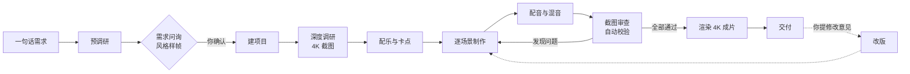

<div align="center">

# 产品宣传视频制作器

**一句话告诉 AI 你要宣传什么，它会自己调研、提问、截图、配乐、配音、剪辑和校验，最后交给你一支 4K 商业宣传片。**

[](LICENSE)


</div>

上面这段动图依次截取了 5 支宣传片的开场，它们全部由这个工具做出来，风格却完全不同。编程学习社区用的是浅色等距 3D 地图，面试刷题平台用的是黑白热血漫画，AI 导航网站用的是明亮的水下 Q 版画风，一个还没正式发布的 AI 模型用的是泄密档案风，零基础编程教程则做成了一支电影预告片。这些风格都不来自预设模板，而是 AI 针对每个产品提出几个方向、画出样图，再由产品作者亲自挑选的结果。

## 这是什么

做一支像样的产品宣传片，通常要经过写脚本、找素材、设计画面、剪辑卡点、配音混音好几道工序。外包一支往往要花几千甚至上万元，自己做又得学会一整套专业软件。

这个项目把整套制作流程写成了一份 AI 能读懂、能照着执行的工作规范（`AGENTS.md`），并配上一个 Remotion 视频工程模板和十几个辅助脚本。你可以把仓库克隆到本地，用 Cursor、Claude Code、Codex、pi 这类 AI 编程工具打开目录；也可以把它安装成一个 Skill，在任何项目里随时调用。无论哪种方式，你都只需要用一句话说明想给什么做宣传片。至于产品有哪些卖点、该用什么风格、哪些画面能打动人，这些不确定的事情都由 AI 先去调研，再拿着具体的选项来问你。

这里说的「产品」范围很广，App、网站、SaaS 工具、开源项目、课程教程、AI 模型、社区和线下活动都可以，只要它有能拿出来展示的界面或作品。

## 快速开始

制作过程会用到 Node.js 18 以上版本、Python 3.9 以上版本和 ffmpeg，请先确认电脑上已经装好这三样软件。用 pi 运行时，pi 本身要求 Node.js 22.19 以上。其余的 Python 依赖和截图用的浏览器内核，AI 在开工前做环境体检时会提示你安装。

接下来可以从两种用法里选一种。如果只是想试一试，或者要宣传的产品没有本地代码，选择克隆仓库更直接；如果你想在自己的产品仓库里随时说一句「给这个项目做个宣传片」，就安装成 Skill。

### 克隆仓库直接使用

把仓库克隆到本地，再安装 Python 依赖和截图用的浏览器内核。

```bash
git clone https://github.com/liyupi/ai-promo-video-maker.git ai-promo-video-maker
cd ai-promo-video-maker
pip install -r template/requirements.txt
playwright install chromium
```

如果不确定环境是否齐全，可以运行一次体检脚本。它只做检查、不会安装任何东西，并且会逐项告诉你缺了什么、该用什么命令补上。

```bash
python3 template/scripts/doctor.py
```

然后用 AI 编程工具打开这个目录就可以开始了。做好的成片会保存在 `outputs/<项目名>/` 目录里。

### 安装成 Skill 使用

这个仓库本身就是一个标准的 Agent Skill，可以用 [skills](https://github.com/vercel-labs/skills) 命令行工具一键安装到 Claude Code、Cursor、Codex 等 AI 工具里。加上 `-g` 表示安装到用户目录，这样所有项目都能用。

```bash
npx skills add liyupi/ai-promo-video-maker -g
```

安装以后，在任意项目里对 AI 说「给这个项目做一支宣传片」，它就会自动调用这个 Skill。这种用法特别适合在产品自己的代码仓库里使用，因为 AI 可以直接读取源码、文档和 README，拿到最准确的一手素材。成片会保存在当前项目的 `宣传片/` 目录里，AI 也会提醒你把这个目录加进 `.gitignore`，以免几个 GB 的工程文件被提交上去。以后想更新到最新版本，运行 `npx skills update` 即可。

### 配置 ElevenLabs（可选）

如果你有 [ElevenLabs](https://elevenlabs.io) 账号，可以把 `.env.example` 复制到工作区根目录并改名为 `.env`，然后填上 API Key；也可以直接设置环境变量 `ELEVENLABS_API_KEY`。这样 AI 就能为片子生成旁白、按分镜定制配乐和音效，还会用语音转写逐句检查旁白有没有读错字。

没有账号也完全可以做片子。这种情况下 AI 会从免费可商用的 Mixkit 曲库里挑选配乐，再用醒目的大字幕代替旁白。

### 用一句话开始

不管用哪种方式，开始的方法都一样：像跟同事交代任务一样说一句话就行。下面是几种常见的说法。

```text
帮我给 https://example.com 做一支宣传片
```

```text
给我的开源项目做一支 1 分钟的介绍视频，仓库地址是 https://github.com/xxx/yyy
```

```text
我们的记账 App 下周上线，做一支能发抖音的竖屏宣传片
```

说完之后，AI 会先花几分钟了解你的产品，然后分两轮向你提问，问题涉及画幅时长、目标受众、风格方向、开场方式、配乐和截图来源等方面。每个问题都会附带一个针对你的产品的推荐选项和理由，拿不定主意时直接选推荐项，或者回答「你来决定」都可以。

等你确认需求以后，AI 就会自动完成剩下的全部工作。中途它只会在三种情况下来找你：需要你登录某个网站以便截图、需要你试听配乐和音色、遇到只有你才能核实的事实。

### 推荐使用的模型

推荐使用 **Claude Opus 5.5** 或者更先进的模型。一支宣传片要经过十几个步骤，以及反复多轮的截图审查和音频校验，模型需要在很长的上下文里始终记得规范里的要求，同时还要有不错的审美判断。能力较弱的模型往往会跳过校验步骤，或者不知不觉把每个产品都做成千篇一律的深色科技风。

## AI 会先给你看样图，再动手

在开始制作之前，AI 会针对你的产品提出 3 到 4 个差异明显的风格方向，并为每个方向画一张样帧，让你直观地看到「这个风格用在我的产品上是什么样子」。下面是面试刷题平台「面试鸭」在需求问询阶段收到的 4 张样帧，最终作者选择了右上角的热血漫画风格。


同样的流程用在 AI 导航网站上，得到的候选完全不同。这一次作者选了右上角的 Q 版小鱼风格，吉祥物就是以网站 logo 为原型设计的。


你可以从中挑一个，也可以混搭，比如「A 的配色加上 C 的角色」。AI 会把你的选择连同其他所有决定一起写进 `需求确认.md`，等你确认无误后才开始制作。

## 成片展示

下面这 5 支片子都是用这个工具完成的。每支片子都经历过几轮真实的修改意见，这些意见后来都被提炼成了规范里的规则。

### 编程导航：等距 3D 导航地图

编程导航是一个编程学习社区。这支片子用代码绘制了一座浅色的等距 3D 城市，把学习路线、项目教程、面试求职串成一条通往 Offer 的道路。片子以三个学编程的痛点开场，第 4.4 秒音乐爆发、品牌登场，随后用 10 张登录后截取的 4K 真实页面逐一展示各个板块。配乐、音效和旁白全部由 ElevenLabs 生成。


### 面试鸭：黑白热血漫画

面试鸭是一个程序员面试刷题平台。片子采用黑白漫画风格，全片只用一种鸭黄色作点缀。开场直接连发 4 道站内浏览量最高的真实面试题，配乐由 AI 按分镜作曲，包含两次爆发和一段回落，旁白恰好在回落段讲解答案。漫画分格由 AI 生成后再经过 4 倍超分，保证在 4K 画面里线条依然清晰。


### 鱼皮 AI 导航：明亮水下 Q 版

鱼皮 AI 导航是一个 AI 工具与资源导航网站。片子的主角是一条以网站 logo 为原型的小鱼，它游过一个个浏览器窗口，窗口里滚动播放着网站各个栏目的真实页面。这支片子前后改了 5 轮，「配乐要先让用户试听」「截图必须保持原比例」「品牌名要逐字校验读音」这几条规则都是在这个过程中总结出来的。


### Claude Fable 5.5：泄密档案风

这是一支比较特别的「抢先看」。片子介绍的 AI 模型版本当时还没有官方发布，只在网友之间灰度流传，所以全片都挂着「未经官方确认」的标注，每个案例都追溯到 X 上的原帖并标明作者和日期。片子结尾放上了官方新闻页的真实截图，用来说明「官方还没有发布」。


### Vibe Coding 教程：电影预告片

这支片子介绍的是一套免费的 AI 编程零基础教程。它采用深色电影预告片风格，用一句「你只需要说人话」引出教程的核心理念，再把真实的应用界面拆成组件，让它们在画面里一块一块地「长出来」。


## 为什么做出来的片子不像模板

让 AI 做视频并不难，难的是做出让人愿意看完的片子。这个项目的大部分功夫都花在了下面几件事情上。

**真实的产品才是主角。** 每个功能段落至少要有一张真实的界面截图或作品图，全片不少于 8 张，还要有一段由 8 张以上真实作品组成的快速蒙太奇。AI 生成的图片和代码绘制的画面只负责包装和转场。项目自带的截图脚本能把任意网页截成 3840×2160 的 4K 图片，遇到需要登录的页面，会弹出一个浏览器窗口请你登录一次。

**节奏有明确的标准。** 早期的片子曾经同时收到过「太快，看不过来」和「太慢，看着拖沓」两种相反的反馈。后来规范里定下了两条底线：一条保证字幕能读完，比如快切镜头至少停留 0.65 秒、网址至少停留 3 秒；另一条保证画面不拖沓，比如开场 3 秒内必须出现痛点或亮点、任何时刻往后 2 秒内必须有新信息。

**声音靠数据来校验。** AI 听不到声音，所以旁白生成后会逐句转写回文字，再和稿子比对，品牌名和网址只要错一个字就判定不合格。混音完成后还会把整段成品重新转写一遍，确认每句旁白都没有被音乐盖住。即便如此，配乐和音色最终仍然要请你亲耳试听后再定。

**每一步都有闸门。** 渲染之前，AI 会检查缺失的文件、分辨率过低的图片和字体缺字；渲染之后，会检查成片的规格、渲染日志里的报错和整体响度，并按场景截图，对照校验清单逐张审查，直到全部通过才交付。

**规则来自真实的反馈。** `references/踩坑记录.md` 收录了 60 多条真实踩过的坑，`references/案例复盘.md` 记录了每支片子收到的修改意见和最终的解决办法。下一个项目开工之前，AI 会先把这些经验读一遍。

## 工作流程

整个流程分为 10 个阶段。其中只有需求确认必须由你拍板，其余阶段都由 AI 自主推进，只在需要登录或试听的时候才来找你。



收到成片后，如果有不满意的地方，直接把意见告诉 AI 就好。它会把你的原话记进修改记录，判断这次改动需要重做哪些步骤，然后只重做必要的部分。比如只换旁白音色时，它不会重新渲染画面，而是直接替换成片里的音轨。

## 项目结构

```text
ai-promo-video-maker/
├── AGENTS.md        # AI 的工作规范，整个项目的核心
├── SKILL.md         # 安装成 Skill 时的入口，内容只是指向 AGENTS.md
├── CLAUDE.md        # 让 Claude Code 也读取 AGENTS.md
├── references/      # 各阶段的详细方法：需求问询、风格菜单、素材获取、配乐卡点、配音、校验清单、踩坑记录、案例复盘
├── template/        # 每个新项目都从这里复制：Remotion 工程、网页播放页、全套脚本
└── outputs/         # 克隆用法下，你的成片会放在这里（不会被提交到 Git）
```

> **AI 工具专属目录不进 Git**
> `.cursor/`、`.claude/`、`.codex/`、`.pi/` 这类目录只属于你的本机配置，已写进 `.gitignore`，不会随仓库分发。所以这些目录里的东西别人克隆后根本拿不到：请勿往里写脚本、素材、规范或模板，也请在提交文档、代码、注释时不要引用这些路径。你需要的一切都在上面这几个受版本控制的目录里。

每支成片的目录里除了视频文件，还会有 `需求确认.md`（你拍板的所有决定和每一轮修改记录）、`调研笔记.md`（每个事实和素材的出处）、可以直接部署的网页播放版，以及完整的工程源码。

## 常见问题

**需要花多少钱？**
这个项目本身完全免费，主要的花费是 AI 编程工具的订阅费。ElevenLabs 是可选项，旁白和音效在免费套餐里就能生成，但免费套餐生成的内容不能商用；按分镜作曲需要付费套餐。不用 ElevenLabs 时，配乐来自免费可商用的 Mixkit 曲库。

**做一支片子要多久？**
大部分时间都花在 AI 自己调研、制作和校验上，你需要参与的只有开头的问询和中途的试听。最终的 4K 渲染根据画面复杂程度不同，一般需要 4 到 18 分钟。

**支持 Windows 和 Linux 吗？**
这个项目主要在 macOS 上打磨，但脚本本身并不依赖 macOS。在 Windows 和 Linux 上，字体会自动改用微软雅黑或 Noto Sans CJK。如果遇到问题，欢迎提交 Issue。

**可以做竖屏视频吗？**
可以。AI 在需求问询阶段会问你画幅和时长，横屏、竖屏或者横竖双版都能做。

**素材的版权怎么处理？**
AI 会在需求问询时和你确认版权边界，并把每张素材的来源记录在 `调研笔记.md` 里。需要特别提醒的是，Remotion 对个人和 3 人以内的公司免费，更大的团队需要购买公司授权，详情请看 [Remotion 的授权说明](https://www.remotion.dev/license)。

**可以只用它做视频的一部分吗？**
可以。`template/` 是一个独立的 Remotion 工程，里面的混音、节拍分析、4K 截图、成片检测等脚本都可以单独使用，各个脚本的用法写在 `AGENTS.md` 的「脚本速查」一节里。

**我的 `.cursor/`、`.claude/`、`.pi/` 目录为什么提交不上？**
这是故意的。这类 AI 工具专属目录只属于你本机，已经在 `.gitignore` 里全部忽略，既不提交、也不随仓库分发。所以请不要往里写任何项目需要的东西，也不要在文档或代码里引用这些路径——别人克隆后拿到的是一个空目录。本机自己用的扩展、提示、快捷命令可以留着，但规范里所有能力都写了「没有它时怎么办」，不依赖任何一个工具专属目录。

## 参与贡献

如果你用它做出了满意的片子，欢迎在 Issue 里分享成品。如果你在制作过程中踩到了新的坑，也欢迎把问题和解决办法补充进 `references/踩坑记录.md` 并提交 PR，下一个使用者的 AI 就会提前避开它。

## 致谢

这个项目站在许多优秀工具的肩膀上，包括负责视频渲染的 [Remotion](https://www.remotion.dev)、提供 AI 配音与作曲的 [ElevenLabs](https://elevenlabs.io)、提供免费可商用配乐的 [Mixkit](https://mixkit.co)、负责网页截图的 [Playwright](https://playwright.dev)，以及处理音视频的 [FFmpeg](https://ffmpeg.org)。

## 开源协议

本项目基于 [MIT](LICENSE) 协议开源。
